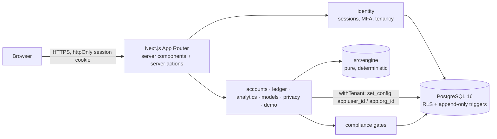

# Architecture

A **modular monolith**: one Next.js application, one Postgres database, domain modules with explicit boundaries so they can be split later.

## Layers
1. **`src/engine`** — pure TypeScript, no I/O, no framework. Decimal money, currencies, dates/day counts, FX policy, price lookup, ledger event types, `PortfolioBook` replay (lots, cash, realised gains, income, expenses, flows), valuation with data-quality issues, returns (TWR, XIRR, annualisation), risk, allocation/concentration/drift, projections, fixed-income maths. Everything numerical in the product comes from here. 70+ unit tests with independent fixtures.
2. **`src/server/*`** — domain services. Each validates input with Zod, authorises, runs in a tenant transaction, writes audit records. Modules: `identity` (auth, sessions, MFA, tenancy, preferences), `accounts`, `ledger` (posting, reversal, codec), `market-data` (price/FX tables, private instruments), `analytics` (dashboard assembly), `models` (target mix drift), `imports` (CSV parsing and import lifecycle), `research` (catalogue search, facts, comparisons, watchlists), `admin` (verified catalogue and market-data imports), `planning` (goals, stress tests), `jobs` (durable Postgres queue + worker), `alerts` (rules, evaluation, notifications), `ai` (research assistant: prompt, tools, policy, provider seam — docs/AI_SAFETY.md), `billing` (plan catalogue, entitlements, subscription lifecycle, invoices, payment-notification framework, admin billing), `reports` (wealth statement data, PDF via pdfkit with embedded Inter, CSV), `support` (help requests), `household` (ownership by member, net worth by person), `connections` (consented bank connections, provider interface, sync to import preview), `admin` console reads (users, organisations, jobs, audit, AI usage, feature gates), `identity/members` (shared spaces, invitations, roles), `compliance` (feature registry + gate), `privacy` (export, erasure), `audit`, `demo`, `platform` (env, errors, rate limiting), `db` (schema, client, tenant context).
3. **`src/app`** — routes. Server components fetch through services; mutations are server actions that call services and return typed `ActionResult`s; route handlers serve exports and health. Client components only for forms and charts.

Look and feel: Paruto design standard (ADR-027) — tokens in `src/app/globals.css`, primitives in `src/components/ui`, shell in `src/app/(app)/layout.tsx`. Education content is typed data in `src/content` rendered by `/learn`. `src/proxy.ts` (Next 16 proxy) sets a per-request CSP nonce, HSTS over HTTPS and request ids; `src/instrumentation.ts` logs server errors as structured JSON. Transaction contexts: `withTenant` (user + organisation), `withUser` (user only), admin transactions (`asAdmin`, re-checked by `app_is_platform_admin()`), and `withBillingSystem` (the billing job and verified payment notifications only). Staff transactions: `asStaff(roles)` (support/compliance/admin, re-checked by `app_staff_role()`). Jurisdictions and record currencies: `src/lib/jurisdictions.ts`. The web app is installable (`src/app/manifest.ts`, `public/sw.js` caching only `public/offline.html`). Planned (not built): payment, email, AI and bank-data provider adapters; native apps.

## Request flow (mutation)
`form → server action → requireAppForAction() (session → MFA → verified email → membership → org) → service(ctx, rawInput) → Zod → withTenant(ctx) { advisory lock (ledger) → replay validation → insert → audit } → revalidate/redirect`.

## Key boundaries
- **Authorisation** happens in services and in Postgres (RLS), never only in UI. Layout redirects are convenience.
- **Tenant context** is set per transaction (`set_config(..., true)`), so pooled connections never leak context.
- **Ledger writes** are serialised per organisation with `pg_advisory_xact_lock`, so two concurrent sales cannot both pass validation.
- **External integrations** (email, market data, AI, payments) are adapters; only development transports exist. Nothing pretends to be connected.

## Analytics cache
`src/server/analytics/cache.ts` wraps the dashboard, account-performance and holdings-performance computations. Inside the same tenant transaction it computes an input fingerprint (a few aggregate queries), returns the stored result if it matches, otherwise computes, stores and returns. Results are JSON (decimal strings), identical to an uncached computation (tested). Bump `ANALYTICS_VERSION` whenever calculation logic changes. Measured on 2,400 events over 5 years: dashboard 390–460 ms uncached → 4 ms cached; holdings performance 850 ms → 7 ms (`npm run test:perf`).

## Background jobs and alerts
A durable queue in Postgres (`jobs`, `src/server/jobs/queue.ts`): `enqueue` with optional dedupe key; workers `claim` with `FOR UPDATE SKIP LOCKED`; failures retry with exponential backoff (30 s doubling, capped at 1 h) up to `max_attempts`, then the job is kept as `dead` with its last error; `recoverStale` re-queues jobs from crashed workers. Handlers must be idempotent. The worker (`npm run worker`, `scripts/worker.ts`) schedules alert evaluations hourly per user (dedupe keys per hour) and processes jobs; it is safe to run several copies.

Alerts (`src/server/alerts`) are evaluated in the owner's tenant context. Notifications carry a unique `(org, dedupe_key)` derived from the event (e.g. alert + price date, alert + instrument + maturity date, alert + milestone), so re-running never notifies twice. Stale prices and FX never trigger level alerts. Wording is factual with no calls to action (unit-tested). Delivery is in-app; email/push will use the same notifications as the source of truth.

## Errors
Services throw `AppError(code, safeMessage)`; actions map to `ActionResult` (`toActionError`) and log unexpected errors server-side without leaking internals. Pages have `error.tsx` and `loading.tsx` states; empty states exist on every list.

## Observability (planned)
OpenTelemetry (Next.js instrumentation hook) and an error monitor are not yet wired — see ROADMAP M4. `/api/health` reports database reachability.
