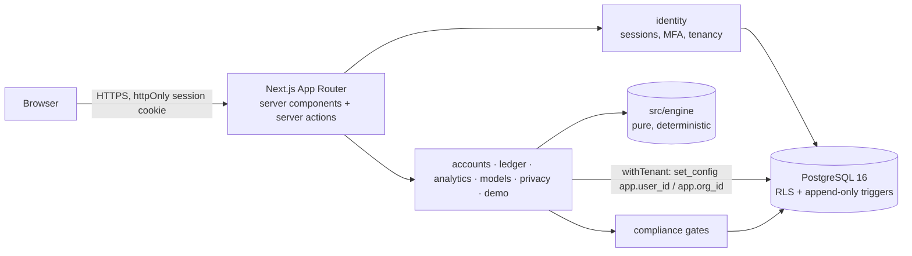

# Architecture

A **modular monolith**: one Next.js application, one Postgres database, domain modules with explicit boundaries so they can be split later.

## Layers
1. **`src/engine`** — pure TypeScript, no I/O, no framework. Decimal money, currencies, dates/day counts, FX policy, price lookup, ledger event types, `PortfolioBook` replay (lots, cash, realised gains, income, expenses, flows), valuation with data-quality issues, returns (TWR, XIRR, annualisation), risk, allocation/concentration/drift, projections, fixed-income maths. Everything numerical in the product comes from here. 70+ unit tests with independent fixtures.
2. **`src/server/*`** — domain services. Each validates input with Zod, authorises, runs in a tenant transaction, writes audit records. Modules: `identity` (auth, sessions, MFA, tenancy, preferences), `accounts`, `ledger` (posting, reversal, codec), `market-data` (price/FX tables, private instruments), `analytics` (dashboard assembly), `models` (target mix drift), `imports` (CSV parsing and import lifecycle), `compliance` (feature registry + gate), `privacy` (export, erasure), `audit`, `demo`, `platform` (env, errors, rate limiting), `db` (schema, client, tenant context).
3. **`src/app`** — routes. Server components fetch through services; mutations are server actions that call services and return typed `ActionResult`s; route handlers serve exports and health. Client components only for forms and charts.

Planned modules (contracts reserved, not built): `instruments` catalogue admin, `goals`, `ai-research`, `notifications`, `subscriptions`, `admin`.

## Request flow (mutation)
`form → server action → requireAppForAction() (session → MFA → verified email → membership → org) → service(ctx, rawInput) → Zod → withTenant(ctx) { advisory lock (ledger) → replay validation → insert → audit } → revalidate/redirect`.

## Key boundaries
- **Authorisation** happens in services and in Postgres (RLS), never only in UI. Layout redirects are convenience.
- **Tenant context** is set per transaction (`set_config(..., true)`), so pooled connections never leak context.
- **Ledger writes** are serialised per organisation with `pg_advisory_xact_lock`, so two concurrent sales cannot both pass validation.
- **External integrations** (email, market data, AI, payments) are adapters; only development transports exist. Nothing pretends to be connected.

## Errors
Services throw `AppError(code, safeMessage)`; actions map to `ActionResult` (`toActionError`) and log unexpected errors server-side without leaking internals. Pages have `error.tsx` and `loading.tsx` states; empty states exist on every list.

## Observability (planned)
OpenTelemetry (Next.js instrumentation hook) and an error monitor are not yet wired — see ROADMAP M4. `/api/health` reports database reachability.
