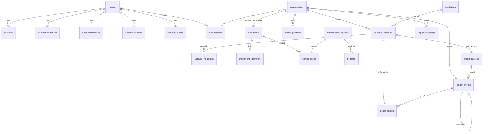

# Database

PostgreSQL 16. Schema in `src/server/db/schema/*.ts` (Drizzle); migrations in `/drizzle` (`0000` generated tables, `0001` hand-written security layer). Migrations run as `wealthos_owner`; the app runs as `wealthos_app` (member of `wealthos_runtime`, NOBYPASSRLS, not an owner) so row-level security always applies.

## Entity relationships

Also: `valuation_snapshots` (analytics cache), `data_versions` (market-data version counter), `audit_events`, `email_outbox`, `rate_limit_buckets`, `regulatory_feature_approvals`, `feature_flags`.

## Table groups
| Group | Tables | Access |
|---|---|---|
| Identity | users, sessions, verification_tokens, user_preferences, consent_records, security_events, email_outbox, rate_limit_buckets | Not tenant-scoped (needed before a tenant is known); service layer only. consent/security logs append-only |
| Tenancy | organizations, memberships | RLS: members read their own; writes only via `app_create_organization()` |
| Portfolio (tenant) | financial_accounts, ledger_events, ledger_entries, account_valuations, model_portfolios, import_batches, import_mappings | RLS by verified membership; viewers read-only |
| Reference | instruments, instrument_identifiers, market_prices, fx_rates, market_data_sources, institutions | Global rows (org_id NULL) readable by all; tenants may add private instruments/prices; global writes via owner/admin only |
| Analytics cache | valuation_snapshots | RLS; derived data only, never authoritative; safe to truncate |
| Compliance | regulatory_feature_approvals (append-only), feature_flags, audit_events (append-only) | |

## Invariants
1. **Tenant isolation:** every tenant row has `org_id`; policies require `org_id = app_current_org()`, which returns the org in context *only if the user in context is a member*. Forged org ids see nothing. (tests/integration/tenancy.test.ts)
2. **Cross-tenant references are impossible:** ledger entries and valuations reference accounts and events through composite foreign keys `(org_id, id)`.
3. **Append-only history:** `forbid_mutation()` triggers reject UPDATE/DELETE on ledger_events, ledger_entries, account_valuations, audit_events, security_events, consent_records and regulatory_feature_approvals unless the current user owns the table (migrations, erasure function). The runtime role also lacks UPDATE/DELETE grants.
4. **One reversal per event:** unique index on `ledger_events.reverses_event_id`; reversals reference events in the same organisation.
5. **Idempotent posting:** unique `(org_id, idempotency_key)`.
6. **Ledger consistency:** `ledger_entries` are derived from the engine's replay at posting time; their per-account sums equal replayed cash balances (integration test).
7. **No negative holdings:** posting replays the entire ledger with the new event; any resulting oversell is rejected.
8. **Exact amounts:** `numeric(38,10)` money, `numeric(38,12)` quantities/prices, `numeric(38,16)` FX; read and written as strings.
9. **Ownership range:** `0 < ownership_percent ≤ 100`; masked account numbers ≤ 4 characters; no credential columns exist.
10. **Import lifecycle:** `guard_import_batch()` allows only previewed → committed | discarded and committed → rolled_back; file, account and organisation never change; committed rows/mapping are frozen; batches cannot be deleted by the runtime role. Raw file text exists only while previewed.
11. **Cache correctness:** a `valuation_snapshots` row is served only when its `input_fingerprint` equals the fingerprint of the current inputs: ledger events and valuations (append-only: count + latest insert), accounts (count + latest `updated_at`, forced on every update by `touch_updated_at()`), the organisation row, the market-data version (bumped by statement triggers on `market_prices`, `fx_rates`, `instruments`, so in-place corrections invalidate too) and the code's `ANALYTICS_VERSION`.
12. **Provenance:** every price/FX row has a source, methodology, observation date, retrieval timestamp and verification state; sources carry licence notes and freshness thresholds.

## Migration policy
Generated SQL is reviewed before commit. Destructive changes need a two-step plan (expand → backfill → contract) and a backup. Never edit a migration that has run in a shared environment; add a new one. (`0000` was amended once, before any shared deployment, to create the `citext` extension.)

## Not yet built (validated against the domain first, per the directive)
corporate_actions (catalogue-level), fund_yields, treasury_auctions, holdings tables (positions are derived from the ledger), goals, projection_scenarios, watchlists, alerts, notifications, ai_conversations, ai_source_references, subscriptions, payments, entitlements. Holdings are currently derived on read from the ledger, which is the source of truth; snapshots will be a cache, never authoritative.
